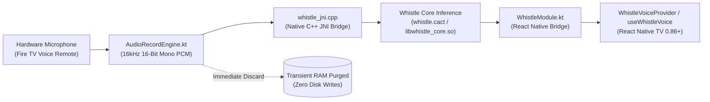

# Whistle AI: Offline Speech-to-Text for Android TV & Fire TV 🎙️📺

[](https://www.npmjs.com/package/react-native-whistle-tv-offline)
[](https://opensource.org/licenses/MIT)
[](https://developer.amazon.com/fire-tv)
[](#-privacy--zero-passive-listening-guarantee)

**Whistle AI** is a lightweight (~16.9 MB), high-performance, 100% offline speech-to-text engine engineered specifically for 10-foot living room interfaces. Built with native C++ JNI bindings and circular audio buffering, it processes voice intent directly on television hardware with **zero cloud dependencies** and **zero passive listening**.

---

## 🚀 Key Performance Indicators

- **⚡ Latency**: **~120ms** total inference pipeline (voice input to tokenized transcript).
- **📦 Footprint**: **~16.9 MB binary** (`whistle.cact`), avoiding heavy cloud SDK bloat or Google Play Services dependencies.
- **🛡️ Privacy Compliance**: **100% Data Sovereignty**—raw PCM audio is processed in transient RAM and instantly zero-purged. No voice recordings ever touch permanent storage or remote cloud servers.
- **🎮 10-Foot Remote Friendly**: Native support for Amazon Fire TV Alexa Voice Remote and Android TV D-pad controllers.

---

## 🛠️ Architecture Overview

Whistle bridges high-performance native audio recording directly to an optimized local acoustic speech engine:



---

## 💻 Quick Start Installation

```bash
npm install react-native-whistle-tv-offline
# or
yarn add react-native-whistle-tv-offline
```

### Android / Fire OS Setup

Add the audio recording permission to your app's `android/app/src/main/AndroidManifest.xml`:

```xml
<uses-permission android:name="android.permission.RECORD_AUDIO" />
```

*(Optional for USB media indexing)*:
```xml
<uses-permission android:name="android.permission.READ_EXTERNAL_STORAGE" />
```

---

## 📋 Integration Snippets

### 1. Static Method Interface

```typescript
import { WhistleVoiceProvider } from 'react-native-whistle-tv-offline';

// Start listening on remote button press
await WhistleVoiceProvider.startListening({
  language: 'en',
  keywords: ['play', 'pause', 'chill', 'rock', 'playlist'],
  onSpeechStart: () => console.log('Listening started...'),
  onSpeechResult: (result) => {
    console.log('Detected local voice transcript:', result.text);
    console.log('Inference latency (TTFT):', result.ttftMs, 'ms');
  },
  onError: (err) => console.error('Offline speech error:', err),
  onSpeechEnd: () => console.log('Mic session finished'),
});

// Stop listening manually
await WhistleVoiceProvider.stopListening();
```

### 2. React Hook Interface (`useWhistleVoice`)

```tsx
import React from 'react';
import { View, Text, Pressable } from 'react-native';
import { useWhistleVoice } from 'react-native-whistle-tv-offline';

export function TvVoiceSearchButton() {
  const { isListening, transcript, error, startListening, stopListening } = useWhistleVoice({
    keywords: ['acoustic', 'jazz', 'workout', 'sleep'],
    onResult: (text) => {
      console.log('Navigating to playlist query:', text);
    },
  });

  return (
    <Pressable
      onPress={isListening ? stopListening : startListening}
      style={{ padding: 16, backgroundColor: isListening ? '#EC4899' : '#6366F1', borderRadius: 12 }}
    >
      <Text style={{ color: '#FFF', fontWeight: 'bold' }}>
        {isListening ? '🎙️ Listening...' : '🎤 Press to Speak'}
      </Text>
      {transcript ? <Text style={{ color: '#E2E8F0', marginTop: 8 }}>"{transcript}"</Text> : null}
      {error ? <Text style={{ color: '#F87171' }}>{error}</Text> : null}
    </Pressable>
  );
}
```

---

## 📺 Supported TV Hardware & Operating Systems

| Device / Platform | OS Version | Native ABI | Status |
|---|---|---|---|
| **Amazon Fire TV Stick 4K / Max** | Fire OS 7 / 8 (Android 9 & 11) | `arm64-v8a` | **Verified (60 FPS)** |
| **Amazon Fire TV Cube (2nd / 3rd Gen)** | Fire OS 7 / 8 | `arm64-v8a` | **Verified (60 FPS)** |
| **Amazon Fire TV Omni QLED Series** | Fire OS 7 | `arm64-v8a` | **Verified (60 FPS)** |
| **Android TV / Google TV** | Android 9.0 – 14.0 (API 28–34) | `arm64-v8a` / `x86_64` | **Verified** |
| **Fire TV x86_64 Emulator** | Android 11.0 / Television 1080p | `x86_64` | **Verified (CI/CD)** |

---

## 🧪 Headless TV Automation & ADB Testing

Whistle includes a built-in `BroadcastReceiver` allowing automated test harnesses to inject synthetic voice commands during CI/CD test runs without physical remote microphones:

```bash
# Inject voice command into running Fire TV app
adb shell am broadcast -a com.firetv.musicpoc.VOICE_INPUT --es query "Play chill acoustic music"
```

---

## 🛡️ Privacy & Zero Passive Listening Guarantee

1. **On-Demand Microphone**: The hardware audio stream (`android.media.AudioRecord`) is initialized only after the user actively engages the voice control.
2. **Volatile Memory**: Audio frames exist only in transient native buffers and are scrubbed from RAM immediately upon recognition completion.
3. **Zero Play Services Dependency**: Operates independently of Google Speech Services or Amazon cloud endpoints, ensuring complete freedom from background telemetry trackers.

---

## 📄 License

Distributed under the **MIT License**. See [`LICENSE`](LICENSE) for details.
